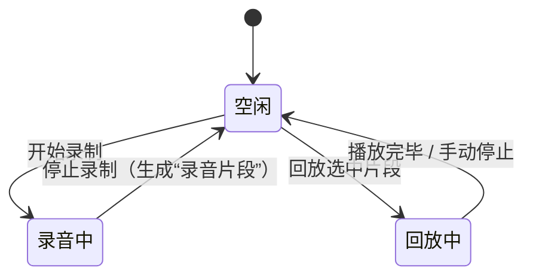
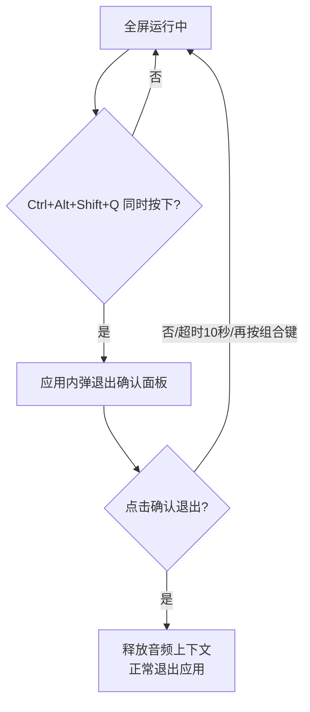

# 键盘模拟钢琴 EXE 应用 · 产品需求文档（PRD）

> 版本：v1.2（第三期：88 键音域 + 顶栏功能按钮化）
> 日期：2026-11-05
> 状态：第一/二期已交付；第三期方案已确认（P3，见 §2.4.1）
> 参考对象：https://www.xiwnn.com/piano/b/

---

## 1. 背景与目标

### 1.1 背景

市面上的浏览器钢琴模拟器（如 xiwnn.com/piano）把电脑键盘映射为琴键，用户敲击键盘即可发声，但这种形式存在四个问题：

1. **浏览器受限**：依赖网络打开网页，无法离线使用；无法作为独立桌面程序分发给孩子；键盘焦点被浏览器窗口抢占/误触。
2. **键盘覆盖不全**：普通网页只映射了字母区 + 数字行的二十几个键，108 键键盘的大量键位（F 行、方向键、小键盘、编辑键）闲置。
3. **无录制回放**：孩子弹奏的片段无法保存重听，只能现场演奏。
4. **容易被退出**：网页可以随手关掉（标签页关闭 / Alt+F4），不适合无人看管时给低龄儿童独立使用。

### 1.2 目标用户与核心场景

- **主体用户**：学龄前至小学低年级儿童（约 3 ~ 10 岁），在家长指导下独立使用。
- **核心场景**：孩子打开应用 → 全屏钢琴界面 → 敲击键盘任意键发出琴声 → 自由演奏/触发儿歌自动弹奏 → 录制自己的演奏并回放。
- **监护人关切**：应用不易被误退出；儿歌内容内置无需联网；声音真实（接近钢琴音色）。

### 1.3 产品决策

| # | 决策点 | 结论 |
|---|---|---|
| D1 | 技术形态 | Windows 桌面 EXE 应用（Electron 套壳） |
| D2 | 音源 | 内嵌真钢琴采样（完整 88 键、多力度层，约 300MB 安装包） |
| D3 | 加载策略 | 启动全量预加载采样，首个琴键零延迟发声 |
| D4 | 乐器种类 | 仅钢琴一种音色（第一期） |
| D5 | 键盘策略 | 虚拟键盘按真实钢琴 **88 键（A0~C8，MIDI 21~108）** 渲染；物理键同一套指法经**音区切换**滚动覆盖全部 88 音；功能控制由**顶栏鼠标按钮**承担（第三期起 F 区不再绑定功能） |
| D6 | 退出保护 | **固定四键组合 Ctrl+Alt+Shift+Q** 全屏下同时按下才弹退出确认 |
| D7 | 开发分批 | 第一批：发声引擎 + 键位映射 + 录制回放（含本地持久化）+ 儿歌 + 防退出 + 全屏（已交付）；第二批：模式系统 + 前端视觉（见 §2.4） |
| D8 | 第二期交互形态 | 四大模式（弹奏/欣赏/练谱/挑战）共享「顶栏 + 可视化区 + 底部虚拟键盘」三段布局，F1 循环切换；虚拟键盘仅物理键盘输入，**不做鼠标/触摸弹琴** |
| D9 | 第三期：88 键 + 按钮化 | 虚拟键盘渲染真实钢琴 88 键（A0~C8）；物理键经**音区切换**（顶栏按钮 ±1 八度）滚动覆盖；**F 区删除**（F1~F12 映射为 none），全部功能改为顶栏鼠标按钮 |

### 1.4 预期可观察结果

- 打开应用后即全屏，无菜单栏、无任务栏图标（防误触退出）。
- 儿童按下键盘**任一琴键**（琴键 = 映射为音高的键；功能键除外），立即听到真实钢琴音，可同时按下多个键（多复音）。
- 儿童可一键触发预置儿歌自动弹奏；可录制一段弹奏并回放，可反复重听。
- 监护人同时按住四键组合（Ctrl+Alt+Shift+Q）才能退出，退出需经确认；已录制的弹奏保存在本地，关机后仍可回放。
- 约 300MB 采样在启动 1~3 秒内完成加载，加载期间界面显示进度，加载完成后全部琴键即时发声。

---

## 2. 范围

### 2.1 用户旅程（核心闭环）

```
打开应用 → 全屏加载（进度提示）→ 加载完成
  → 敲击琴键发声（多复音）
  → 触发儿歌自动弹奏
  → 录制弹奏 → 回放
  → 完成演奏 → （监护人）四键组合（Ctrl+Alt+Shift+Q） → 退出确认 → 退出
```

### 2.2 P0 范围（第一期必做）

| 编号 | 能力 | 说明 |
|---|---|---|
| P0-1 | 全屏启动 | 启动即全屏、无菜单栏、隐藏任务栏图标，防止儿童误退出 |
| P0-2 | 真钢琴发声引擎 | 内嵌采样、多复音、延音释放，88 键音域（21~108）全覆盖发声 |
| P0-3 | 键位映射 | 物理键（event.code）↔ 琴键音高映射表 + 音区偏移（同指法滚动 88 键） |
| P0-4 | 儿歌 | 若干首内置儿歌自动弹奏，由特定键 / 组合键触发 |
| P0-5 | 录制与回放 | 记录 note on/off 事件序列并本地持久化，回放驱动同一发声引擎 |
| P0-6 | 防退出 | 固定四键组合（Ctrl+Alt+Shift+Q）全屏下按住才弹退出确认 |
| P0-7 | 音色切换预留 | 第一期仅钢琴，但架构预留乐器扩展位（切换列表为空） |

### 2.3 P1 范围（第一期增强，时间允许时做）

| 编号 | 能力 | 说明 |
|---|---|---|
| P1-1 | 录制导出 MIDI | 已录制片段可导出为 .mid 文件（可选保存路径） |
| P1-2 | 音量/速度调节 | 全局音量、回放速度（0.5x~1.5x） |
| P1-3 | 变调（八度偏移） | 整体高/低一个八度切换，适配儿歌曲目音域 |
| P1-4 | 波形纸面 / 时值显示 | 回放时示意当前音符位置（文本/进度） |

### 2.4 第二批（P2，第二期实施范围，2026-11-03 评审通过）

| 编号 | 能力 | 说明 | 依赖 |
|---|---|---|---|
| P2-1 | 模式系统 | 模式管理器 + F1 循环切换（弹奏/欣赏/练谱/挑战），顶栏模式指示 | — |
| P2-2 | 弹奏模式 | 虚拟钢琴键盘（C3–A6 映射键位）+ 按下动画 + 音名气泡 + 中央C标注 | P2-1 |
| P2-3 | 欣赏模式 | 儿歌/录音自动演奏可视化：音符瀑布 + 虚拟键自动点亮，免判定 | P2-2 |
| P2-4 | 练谱模式 | 跟弹练习：音符方块标注键位字母，落到键盘线判定命中；得分/连击/星级；三档速度 | P2-3 |
| P2-5 | 简谱字幕带 | 卡拉OK式简谱随演奏/儿歌/回放高亮当前音符 | P2-3 |
| P2-6 | 节奏挑战 | 打地鼠式：随机琴键亮起 + 倒计时，限时命中得分，关卡 + 星级 | P2-2 |
| P2-7 | 录音室 | 录音回放钢琴卷帘时间轴（横向音符块 + 播放头） | P2-3 |
| P2-8 | 统一时钟 | Playback 调度 setTimeout → rAF，为瀑布/判定/字幕/卷帘提供时间基准 | — |

> 详细规则见 §4.9（FR-09）。硬约束：视觉层订阅 NoteEvent 事件流（纯订阅者），发声/录音/儿歌逻辑零改动；虚拟键盘仅物理键盘输入。

### 2.5 明确排除（防止范围蔓延）

- **不联网**：本应用完全离线，不采集任何数据，无更新，无广告。
- **不做音色内购/订阅**：一期仅钢琴。
- **不做编曲/多轨道**：不做多轨编曲、加花、软音源换肤；节拍器未列入本期，P1 再评估。
- **不做移动端/平板适配**：仅 Windows 桌面。
- **不做鼠标/触摸弹琴**（第二期确认）：虚拟键盘仅与物理键盘输入联动，界面不响应点击发声。

---

## 3. 产品模型（核心对象与状态）

### 3.1 核心对象

| 对象 | 定义 | 关键字段 |
|---|---|---|
| 琴键（Key） | 一个物理键盘按键 + 绑定音高 | code、音高、发声配置、所属键盘区域 |
| 音符事件（NoteEvent） | 一次按下/抬起 | 动作（down/up）、音高、时间戳 |
| 录音片段（Recording） | 一段音符事件序列 | 事件列表、时长、音符数、标题、创建时间 |
| 曲目（Song） | 一首儿歌的自动播放数据 | 标题、音符序列（音高+时长）、推荐音区 |
| 映射方案（Layout） | 键 → 音高/功能的完整对应 | 键位表、默认方案名称 |

### 3.2 录制/回放对象生命周期



### 3.3 状态规则

- 录制与回放**互斥**：录制中不可回放；回放中不可开始新录制。
- 回放优先：回放中若用户敲击琴键，新敲击琴键**立即发声并打断回放**（回放停止，回到空闲；录音片段保留）。

---

## 4. 功能需求

### 4.1 FR-01 全屏启动与窗口保护

| 项 | 规则 |
|---|---|
| 触发 | 双击 exe 启动 |
| 处理 | 窗口无边框、全屏铺满、无菜单栏；`setSkipTaskbar(true)` 隐藏任务栏图标；Alt+F4/关闭被拦截 |
| 结果 | 呈现全屏钢琴界面；任务栏无图标；窗口无法被鼠标拖动/调整 |
| 状态 | 全屏（唯一常态）；退出流程见 FR-08 |
| 异常 | 多显示器：默认在主显示器全屏；分辨率切换自动跟随 |

### 4.2 FR-02 真钢琴发声引擎

| 项 | 规则 |
|---|---|
| 触发 | 任意琴键按下（keydown，忽略长按重复 `e.repeat`） |
| 处理 | 渲染进程调度：查找映射音高 → 从预加载采样库取 AudioBuffer → 新建 AudioBufferSourceNode → 经主 GainNode 输出 → note-off 用短释放包络（5~50ms）消 click |
| 结果 | 按下即发声；同时按下多键全部发声（多复音） |
| 复音上限 | 默认 64；超限时最旧未释放音被偷占（voice stealing） |
| 包络 | 起音快（接近真实钢琴），释放用指数衰减；不出现爆音/咔哒声 |
| 采样加载 | 启动全量预加载：88 键 × 多力度层；加载进度 UI；加载完成前琴键按下不发声、提示"加载中"（不做延迟补放，避免音符滞空） |
| 性能基线 | 10~20 复音并发 CPU 占用 <5%；内存约 300MB（解码后常驻） |
| 异常 | 音频设备中断（声卡移除）：随窗口状态恢复；单键按下无声音时在状态栏提示"此键未绑定音高"（若该键属于功能键） |

### 4.3 FR-03 键位映射（88 键音域 + 顶栏按钮化）

**设计原则**：`event.code`（物理键位）映射，而非 `event.key`（字符），避免大小写/输入法/NumLock 干扰。

**第三期变更**：F 区（F1~F12）映射为 `none`（删除功能绑定）；全部功能控制改用**顶栏鼠标按钮**（模式/录音/回放/儿歌/音量/音区）。物理键同一套指法 + **音区偏移**滚动覆盖 88 键：当前音区为 11 个半音的窗口，音区键（KeyQ 等）发声 = 基础 midi + 音区偏移；顶栏「音区 − / +」按钮 ±1 八度（外包络 ±1，跨 88 键全程可及）。

| 键盘区域 | 默认映射 | 说明 |
|---|---|---|
| 主键区字母行 `A S D F G H J K L` | 自然音阶（白键）| 从中央 C 起（C4~D5），约 1 个八度余 |
| 主键区顶行 `Q W E R T Y U I O P` | 黑键（升号）+ 延伸白键 | 与字母行构成完整半音阶 |
| 主键区底行 `Z X C V B N M` | 低音区延伸 | 向下一个八度 |
| 数字行 `1 2 ... 0` | 高音区延伸 | 向上延伸 1 个八度 |
| 小键盘 | 琴键延伸（复用中央区音高+1 个八度）| 满足"尽量占满发声" |
| F 行 `F1~F12` | **none（第三期起删除功能绑定）** | 功能改顶栏按钮 |
| Ctrl / Alt / Shift | 不发声（辅助保留） | 组合键 Ctrl+Alt+Shift+Q 为主进程全局快捷键 |
| Win 键 | 不映射（系统级，无法拦截）| 文档说明 |
| PrintScreen / 媒体键 | 系统占用不可靠 | [TBD] 视调研结果决定是否用全局钩子捕获 |

> 虚拟键盘渲染完整 **88 键（A0~C8，MIDI 21~108）**，高亮当前音区；中央 C 徽标；键位字母标注跟随音区实时更新。音区范围限制：最低音 ≥21、最高音 ≤108。

**统一功能表（唯一出处，FR-04/05/06 都引用此表；P3 起全部为顶栏按钮，快捷键不再提供）**：

| 按钮 | 功能 |
|---|---|
| 模式 chips（弹奏/欣赏/练谱/挑战） | 切换模式（原 F1） |
| 录音 / 停止 | 开始 / 停止录制（原 F2/F3） |
| 回放 / 停止 | 回放最新片段 / 打断（原 F4/F5） |
| 儿歌面板 / 播放 / 停止 | 打开面板 / 播当前曲 / 停（原 F6/F7/F8） |
| 音量 − / + | 全局音量（原 F9/F10） |
| 音区 − / + | 八度偏移（原 F11/F12） |
| 方向键 ↑/↓ | 选曲（保留键盘操作）|
| 方向键 → / Enter | 播放当前曲（保留键盘操作）|
| Esc | 关闭弹出面板 |
| Ctrl+Alt+Shift+Q | 退出确认（FR-06，全局快捷键，不发声）|

> 儿歌面板内选曲仍支持 ↑/↓ 与 Enter（保留），但打开面板/播放/停止均可鼠标操作。

**映射表输出**：以 JSON 配置形式内置，开发期可编辑；默认方案如上，未来可扩展为多方案切换（P1 再评）。

### 4.4 FR-04 录制与回放

| 项 | 规则 |
|---|---|
| 触发（录制）| F2 开始录制；F3 停止录制（见功能键位表） |
| 触发（回放）| 录音片段存在时，F4 回放最新片段；F5 停止/打断 |
| 录制内容 | 记录每个音符的 down/up 事件 + 高精度时间戳（performance.now），不录音频流 |
| 存储 | **本地持久化**：录音片段保存到本地（Electron userData 目录，JSON 或 .mid），重启后仍可回放；片段列表保留最近 N（默认 10）条，可删除 |
| 回放 | 用同一发声引擎按时间线调度音符；回放速度可调（P1）；回放中实时高亮当前音符（文本/进度条） |
| 状态互斥 | 见 §3.3 |
| 异常（空）| 无片段时按回放键提示"暂无录音" |
| 异常（覆盖）| 录音中再次按开始 → 忽略；回放中按录制 → 打断回放并开始新录制 |

### 4.5 FR-05 儿歌自动播放

| 项 | 规则 |
|---|---|
| 选曲 | 内置 10 首左右经典儿歌（小星星、两只老虎、数鸭子、粉刷匠、铃儿响叮当等）[TBD: 曲目清单与数量确认] |
| 触发 | F6 打开儿歌面板，方向键/数字键选曲，Enter 播放；或 F7 直接播放当前选定曲目；F8 停止（功能键位表） |
| 播放 | 复用回放引擎按时间线调度；可随时按琴键打断 |
| 转调 | 曲目按适合儿童音域的音高存储，自动落在映射琴键可用音域内 |
| 音色 | 与演奏共用同一钢琴音色 |
| 力度 | 内置 3 档力度（弱/中/强）模拟弹奏起伏 |
| 异常 | 播放中再次选曲 → 停止当前、播新曲；空选（无曲目）→ 提示 |

### 4.6 FR-06 防退出（固定四键组合 Ctrl+Alt+Shift+Q）

| 项 | 规则 |
|---|---|
| 组合键 | **Ctrl + Alt + Shift + Q**（固定，本期不可改；P1 提供设置面板，见 §7） |
| 生效时机 | 全屏下始终监听（含加载阶段） |
| 触发结果 | 弹出**应用内**退出确认面板（非系统对话框）：显示"确认退出？" 和两个按钮 |
| 确认 | 用鼠标点击"确认退出" → 正常退出 |
| 取消 | 点击"取消" / 再次按键 / 超时（10 秒）→ 关闭面板继续使用 |
| 按键免责 | 组合键按下瞬间**不触发琴键发声**（组合键被主进程 globalShortcut 捕获，渲染进程收不到，天然避免误发声）|
| 异常 | 组合键注册失败（与其他软件冲突）→ 启动时提示一次，仍可用组合键方案 B（见下） |

> **实现注记**：
> - 组合键用**主进程 globalShortcut** 监听（最稳，且天然屏蔽该组合进入渲染进程）；
> - 若某环境 globalShortcut 冲突，备选方案：注册原生键盘钩子（uiohook-napi 等）在渲染层外计数**任意**四键同时按下；
> - 退出确认面板为应用内 UI，避免系统对话框被 kiosk 模式遮挡。

### 4.7 FR-07 全屏 Kiosk 表现

| 项 | 规则 |
|---|---|
| 呈现 | 无边框全屏，铺满主显示器，无菜单栏/任务栏图标 |
| 可操作 | 鼠标仅用于点击应用内按钮（退出面板、儿歌面板） |
| 限制声明 | Alt+Tab / Win / Ctrl+Alt+Del / Win+L 属于系统级，本应用**无法也不尝试**拦截；文档明确告知监护人 |
| 退出路径 | 唯一路径 = 四键组合 → 确认（FR-06） |
| 二次启动 | 再次双击 exe 会激活现有窗口而非开新实例（单实例锁） |

### 4.8 FR-08 退出流程



### 4.9 FR-09 模式系统与前端视觉（第二批 P2-1~P2-8，已评审）

**4.9.1 全局布局（所有模式共享）**

| 区 | 内容 |
|---|---|
| 顶栏 | 模式指示 chips + 功能按钮（录音/回放/儿歌/音量/音区，P3 起）+ 状态（录音/回放/儿歌…） |
| 可视化区 | 随模式变化：气泡天空 / 音符瀑布 / 简谱字幕 / 挑战大屏 |
| 底部虚拟键盘 | 全模式共享：**88 键（A0–C8）** 渲染、当前音区高亮、键位字母标注跟随音区、中央C徽标；**仅物理键盘输入** |

**4.9.2 弹奏模式（默认，P2-2）**

| 项 | 规则 |
|---|---|
| 按下动画 | note down → 虚拟键下沉 + 高亮；note up → 还原 |
| 音名气泡 | 触发键正上方飘出音名（do re mi…）短暂上飘渐隐；高频触发时节流合并 |
| 联动 | 演奏 / 回放 / 儿歌三来源统一驱动同一动画 |
| 中央 C | 虚拟键上标注，帮助儿童辨认音区 |

**4.9.3 欣赏模式（P2-3）**

| 项 | 规则 |
|---|---|
| 来源 | 儿歌（F6/F7/F8 不变）与录音回放（F4/F5） |
| 表现 | 音符瀑布下落（方块标注键位字母），落到键盘线自动点亮虚拟键；免判定 |
| 播放条 | 曲名 + 进度 + 停止；演奏中按任意琴键打断（沿用 §3.3） |

**4.9.4 练谱模式（P2-4）**

| 项 | 规则 |
|---|---|
| 选曲 | 复用儿歌面板（F6），Enter 进入跟弹 |
| 玩法 | 音符方块从顶部落向键盘线，方块标注待按键位字母（类打字游戏） |
| 判定 | 音符到线 ± 命中窗口内按下同名字键 = 命中（+10，连击 +1）；错键/超时 = miss，连击清零（温和反馈，无惩罚性音效） |
| 速度 | 0.5x / 0.75x / 1x 三档 |
| 结算 | 曲末星级（按命中率）+ 得分 + 最佳连击 |

**4.9.5 简谱字幕带（P2-5）**

| 项 | 规则 |
|---|---|
| 数据 | songs.js 曲谱补简谱序列（1 2 3 5…） |
| 表现 | 演奏/儿歌/回放时顶栏下方一条字幕带，当前音符放大高亮（卡拉OK式） |

**4.9.6 节奏挑战（P2-6）**

| 项 | 规则 |
|---|---|
| 玩法 | 随机琴键亮起 + 倒计时圆环，限时按下得分；连击提升关卡（出题加速 / 双键同按） |
| 目标池 | 仅从当前映射方案已绑定音高的键中抽取 |
| 结算 | 关卡 + 星级；切换模式即退出，无失败惩罚 |

**4.9.7 录音室（P2-7）**

| 项 | 规则 |
|---|---|
| 视图 | 欣赏模式播放录音片段时切换为钢琴卷帘：横向音符块时间轴 + 播放头 |
| 联动 | 「我的录音」面板（既有）选择片段即进入 |

**4.9.8 技术约束**

- 视觉层为**纯订阅者**：订阅 onNoteDown/onNoteUp 事件总线，发声/录音/儿歌逻辑零改动（§5.1）。
- Playback 调度由 setTimeout 改为 **rAF 统一时钟**（瀑布/判定/字幕/卷帘的时间基准）。
- 虚拟键盘 DOM + CSS（transform 动画）；瀑布/卷帘 Canvas 或 DOM + rAF。
- 模式切换 F1 循环；第一期功能键语义全部不变。
- **P3 变更**：F1~F12 删除功能绑定；模式切换与全部功能操作改为顶栏鼠标按钮（原语义不变）。

---

## 5. 共享规则

### 5.1 发声引擎统一调度

- 演奏、回放、儿歌**全部走同一个发声引擎入口**（Engine.play(note, velocity) / release(note)）。
- 复音上限、voice stealing、释放包络等规则对所有来源生效（防互相挤占导致丢音）。

### 5.2 事件时间基准

- 录音与回放统一以 audioContext.currentTime 或 high-res clock 为时间轴，不同来源（真实演奏/儿歌/回放）在同一时钟上可互操作。

### 5.3 键盘事件规范

| 规则 | 内容 |
|---|---|
| 物理键 | 一律用 `event.code` 映射，不用 `event.key` |
| 长按 | keydown 忽略 `e.repeat`，避免长按连发 |
| 焦点 | 全屏下始终捕获键盘；无输入框抢焦点 |
| Alt 冲突 | 窗口 `autoHideMenuBar` + `setMenu(null)`，避免 Alt 激活菜单栏 |

### 5.4 退出保护（全局）

- 唯一退出路径 = 四键组合 + 确认（FR-06/FR-08）。
- 所有 invoked 关闭事件（窗口关闭、系统关机前）→ cancel 并走退出面板。

### 5.5 音域与映射一致性

- 儿歌曲目音高、录音片段音高、实时演奏音高必须落在**当前映射方案**的音域内；切换方案（未来）前后片段音高须有约定（P1 再定义）。

---

## 6. 边界与异常

| 场景 | 处理 |
|---|---|
| 键盘非全键无冲（硬件 6 键无冲）| 文档提示：同时按超过硬件上限会丢键，非应用缺陷 |
| 声卡不可用/被占用 | 启动检测；提示并仍可启动（静音模式），恢复后发声 |
| 采样加载失败 | 重试一次；仍失败提示"音源加载失败"，应用可退出（此场景可通关全局退出） |
| globalShortcut 冲突 | 启动时提示一次；回退到任意四键计数钩子（FR-06 备选） |
| 录音片段为空 | 回放键提示"暂无录音" |
| 儿歌列表为空 | 提示"暂无曲目" |
| 系统级按键拦截（Win/CTRL+ALT+DEL）| 无法拦截，文档说明，源码不在应用层处理 |

## 7. 开放问题与假设

| 标记 | 问题 | 影响 | 需决策 |
|---|---|---|---|
| [TBD] | 儿歌曲目明细与准数 | 影响内置数据量 | 已确认约 10 首（小星星、两只老虎、数鸭子、粉刷匠、铃儿响叮当等），完整曲目明细开发时敲定 |
| [TBD] | 设置面板（组合键是否可改、录音存放位置）| 影响设置 UI；本期组合键固定 | 本期固定，P1 做设置面板 |
| [Assumption] | 88 键音域对儿童足够（无需完整 7 个八度）| 影响采样量与映射范围 | 若需完整音域，采样翻倍 |
| [Assumption] | 安装包 ~300MB 可接受 | 影响发布方式 | 已按"完整采样"确认 |
| [Assumption] | 主显示器全屏即可，无需多屏跟随 | 影响窗口逻辑 | 低风险假设 |
| [Assumption] | 录音片段本地持久化（userData 目录）即满足需求 | 影响录制存储设计 | 已按"本地持久化"确认 |
| [已决策] | 第二期模式范围（欣赏/挑战/简谱字幕/录音室是否纳入） | 影响第二期工作量 | 2026-11-03 评审：六个模块全部纳入（P2-1~P2-8，见 §2.4） |
| [已决策] | 虚拟键盘是否支持鼠标/触摸弹琴 | 影响交互与焦点管理 | 2026-11-03 评审：不做，仅物理键盘输入（D8） |

---

## 8. 附：第一批技术架构示意（供评审参考，不构成 PRD 结论）

```text
┌─────────────────────────────────────────────┐
│  Electron 主进程                            │
│  - 创建全屏无边框窗口（Kiosk）              │
│  - globalShortcut: Ctrl+Alt+Shift+Q → 退出面板  │
│  - 关闭事件拦截 / 单实例锁                  │
└───────────────▲─────────────────────────────┘
                │ IPC（退出指令/全局快捷键事件）
┌───────────────┴─────────────────────────────┐
│  Electron 渲染进程                          │
│  ├─ 发声引擎（Web Audio + 预加载采样库）    │
│  │    · 88键多力度音频缓存                   │
│  │    · 复音管理（64复音+偷占）              │
│  │    · 释放包络（防爆音）                   │
│  ├─ 键盘映射（event.code → 音高/功能）      │
│  ├─ 录制/回放（NoteEvent 序列）             │
│  ├─ 儿歌引擎（曲目数据 → 时间线调度）       │
│  └─ UI（加载进度 / 儿歌面板 / 退出面板）    │
└─────────────────────────────────────────────┘
```

---

*文档结束。第二期开发依据本文件 §2.4（P2-1~P2-8）与 §4.9（FR-09）实施。*
